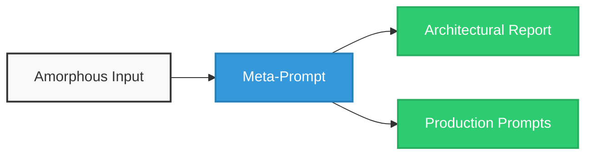

# Workflow Orchestrator Meta-Prompt - User Manual

## Overview

The **Workflow Orchestrator Meta-Prompt** is an advanced prompt engineering tool designed to transform vague, complex, or unformatted objectives into deterministic, production-ready prompt pipelines. It acts as an AI systems architect to eliminate common LLM issues like attention decay, hallucination, and structural degradation in complex workflows.

## How It Works

The meta-prompt analyses your input and generates a **Workflow Orchestrator Report** alongside the exact **Production Prompts** required to execute your task. 

## Step-by-Step Guide

### Step 1: Prepare the Meta-Prompt

Feed the Workflow Orchestrator Meta-Prompt into your preferred Large Language Model. Make sure the LLM system parameters are ideally set to a **Temperature of 0.0** for maximum deterministic quality. 

### Step 2: Define Your Runtime Variables

At the bottom of the prompt under the `<runtime_interface>` block, locate the three input variables. Replace the placeholders with your specific project details: 

1. **`{{USER_OBJECTIVE}}`**: Define what you want the final AI pipeline to achieve (e.g., _"Create an automated system that ingests raw customer feedback emails, categorizes them by sentiment, extracts urgent bug reports, and drafts an engineering ticket."_) 
2. **`{{USER_PRIMARY_INPUTS}}`**: Detail the primary data the downstream prompts will process (e.g., _"Raw text emails from the support inbox."_) 
3. **`{{USER_SECONDARY_INPUTS}}`**: Provide rules, reference guides, style requirements, or hard boundaries (e.g., _"Must flag any mention of security vulnerabilities as Priority 1; response templates must follow the attached corporate tone-of-voice guide."_) 

> [!TIP] Feeding User Input
> Most models allow feeding a separate User Input (Markdown) file without pasting them into the Meta-Prompt.

## Step 3: Run the Prompt

Execute the session. The model will run a Chain-of-Thought thinking protocol to deconstruct your objective, analyse dependencies, choose the best pipeline topology, and map out constraints. 

# Step 4: Extract the Outputs

The system will generate two distinct components: 

1. **The Architecture Report:** A breakdown explaining why it chose a specific structure (Single vs. Multi-Session), a Taxonomy Analysis grouping your variables, and an Execution Map. 
2. **The Production Prompts:** Fully fleshed-out, copy-paste-ready prompts inside strict XML tags. 

## Understanding the Structural Layouts

### 1. Single-Session vs. Multi-Session

- **Single-Session:** Used for lean, straightforward tasks. The generated prompt handles the input and output within one turn. 
- **Multi-Session:** Used when sequential dependencies risk blowing out the LLM's context window or degrading attention. The system creates isolated prompts that pass data to one another. 

### 2. State Hydration & Dehydration

If the system builds a **Multi-Session** pipeline, it utilizes a strict JSON State Schema: 

- **Dehydration:** The instructions at the bottom of an upstream prompt that force the LLM to output its current processing state as a validated JSON object. 
- **Hydration:** The instructions at the top of a downstream prompt that ingest that JSON object to perfectly restore the workflow's state in a brand-new session. 

## Best Practices

- **Be Specific in Inputs:** The output prompts are only as good as the context you provide in the USER_INPUTS. Include explicit rules or edge cases you want the final prompts to avoid. 
- **Do Not Touch System Tags:** When deploying the generated production prompts, keep the `<system_priming>`, `<execution_logic>`, and `<runtime_interface>` XML blocks intact. They guarantee structural integrity. 
- **Validate the JSON State:** If running a Multi-Session workflow, ensure your orchestrator or script passes the JSON state object between prompts exactly as outputted, without altering the `metadata` or `extracted_payload` roots.
